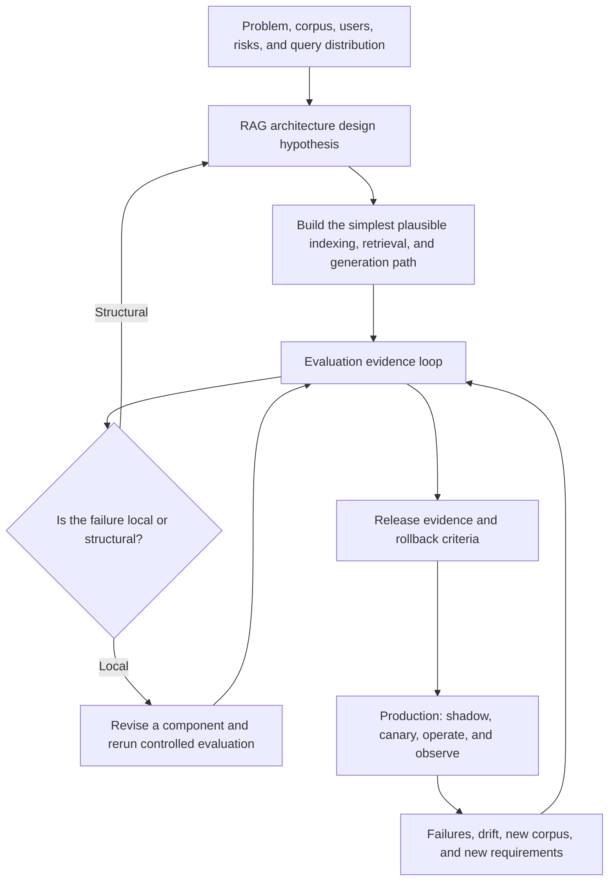

# RAG System Design & Improvement Loop

This is the lifecycle connecting the six RAG clusters without turning the Obsidian graph into a mega-hub. Labels in the diagram are conceptual stages rather than wikilinks.

## Two Architecture Entry Points

### Initial hypothesis

Before building, requirements may rule out the simplest topology. Authorization boundaries, global corpus questions, multi-source composition, or intrinsically iterative tasks can justify testing a richer design immediately. It is still a hypothesis that needs a simpler comparator.

### Evidence-driven escalation

After component optimization, residual failures may reveal that the control flow itself is wrong. Return to architecture selection only when evidence shows that another chunker, retriever, reranker, prompt, or model is unlikely to solve the failure locally.

## Production Feedback Contract

A production observation becomes engineering evidence only after it is preserved as a reproducible case with the relevant corpus, index, prompt, model, policy, trace, expected behavior, and impact. Evaluation owns the experiment; Production owns containment, evidence preservation, rollout, and monitoring.

## Decision Record

For every architectural addition, record:

- failure or requirement that motivates it
- baseline and candidate control flows
- query slices expected to benefit
- added latency, cost, state, permissions, and failure modes
- component and end-to-end evidence
- rollout, observability, and removal criteria

## Part of

← [[RAG Architectures]]
